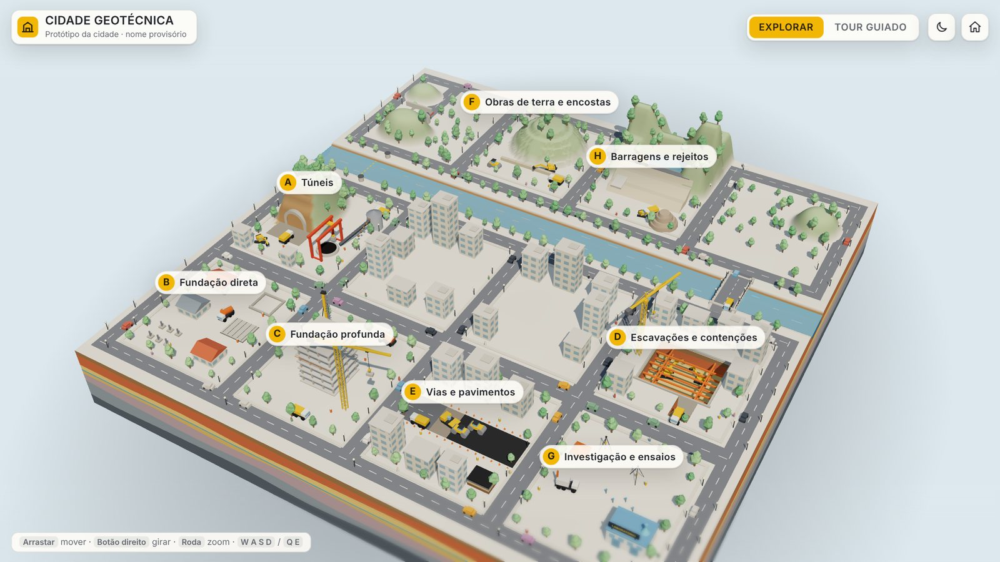
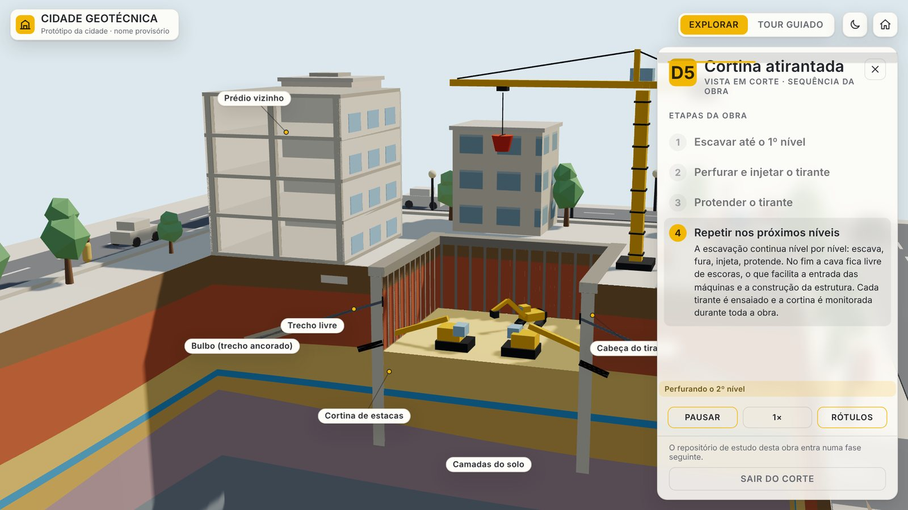
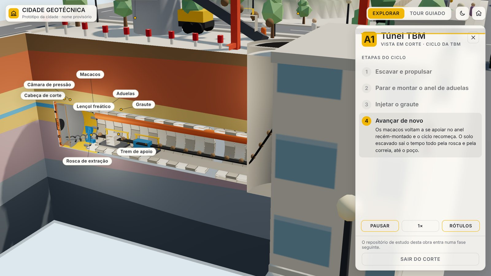
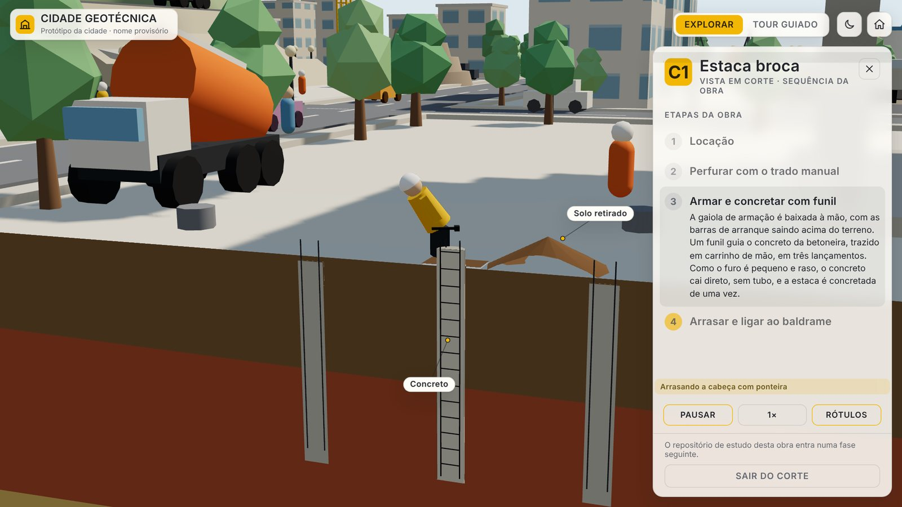
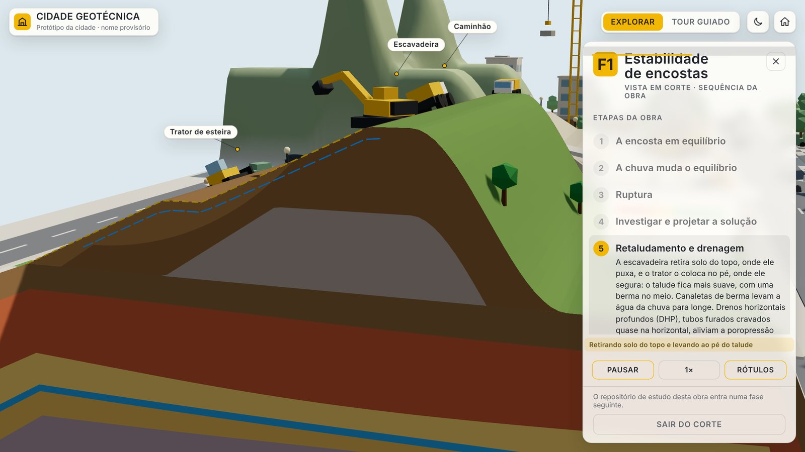
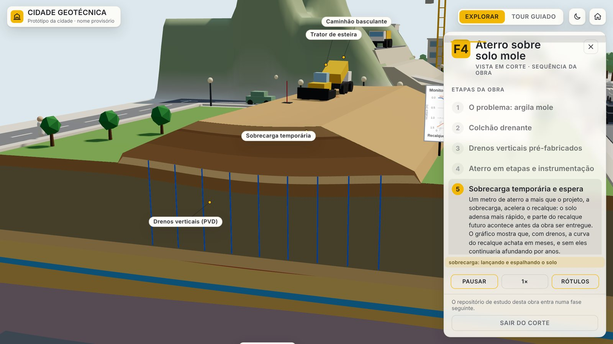
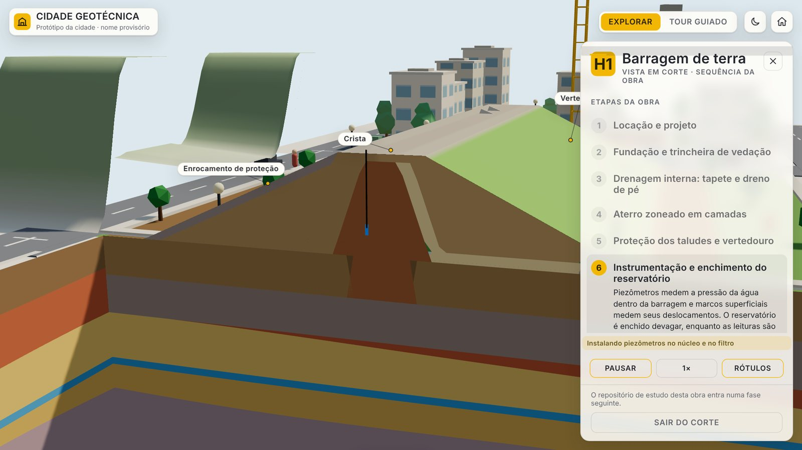
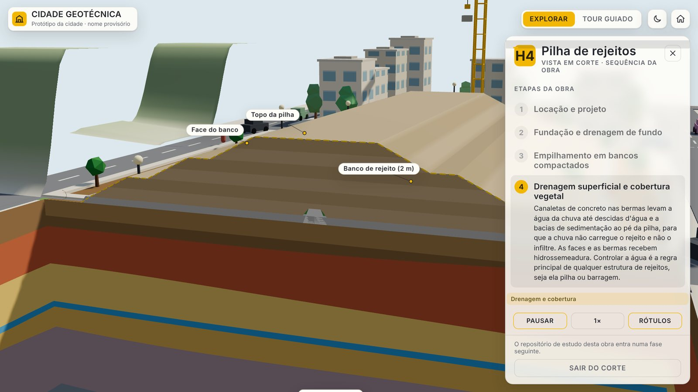
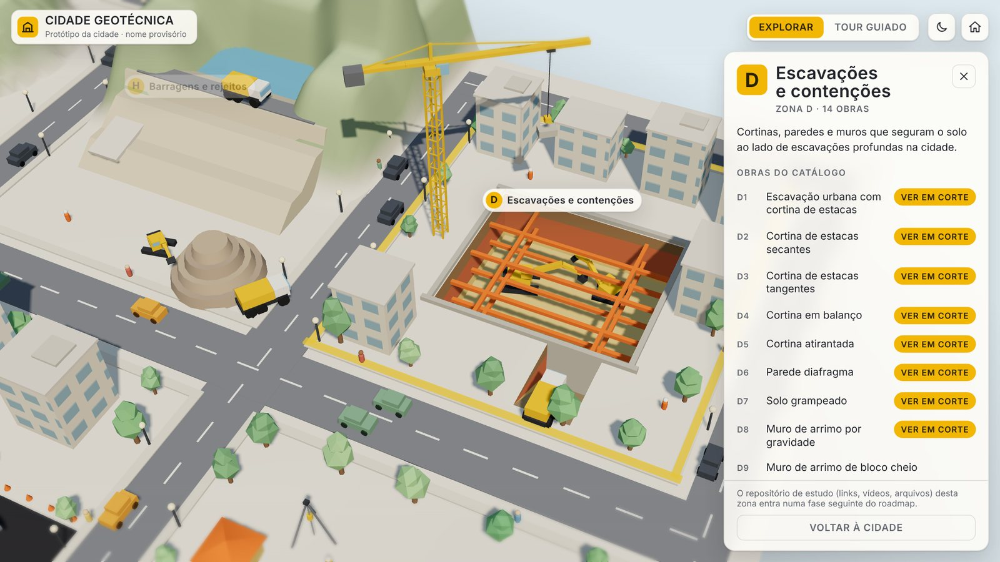
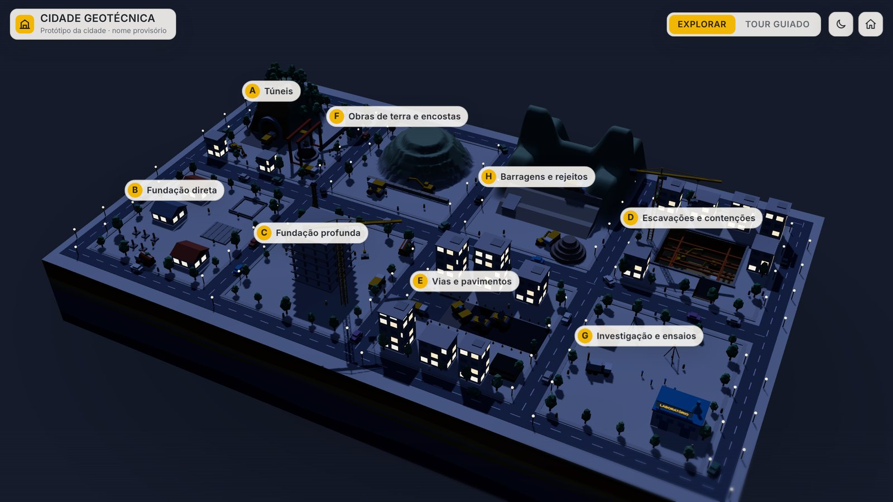

# Cidade Geotécnica

Uma cidade 3D interativa onde cada obra de engenharia geotécnica pode ser aberta **em corte**, com a sequência de execução animada passo a passo: as máquinas, as camadas do solo, o nível d'água e o que acontece embaixo da terra.

**[▶ Abrir a cidade no navegador](https://victortlacerda.github.io/cidade-geotecnica/)**. Funciona no computador e no celular, sem instalar nada.

## 52 obras animadas em corte

A cidade tem oito zonas temáticas. Clique numa zona para ver o catálogo de obras e escolha **Ver em corte**: a câmera entra na seção do terreno e a obra é executada etapa por etapa. O painel lateral explica cada fase, e dá para pausar, mudar a velocidade e ligar ou desligar os rótulos.

| Túnel TBM (A1) | Estaca broca (C1) |
|---|---|
|  |  |
| **Estabilidade de encostas (F1)** | **Aterro sobre solo mole (F4)** |
|  |  |
| **Barragem de terra (H1)** | **Pilha de rejeitos (H4)** |
|  |  |

## Zonas e obras

Um rio corre atrás da cidade. Do outro lado fica uma área afastada com as zonas F e H, ligada à cidade por um túnel que sai da Zona A e passa por baixo do rio, e por uma ponte perto da Zona D.

| Zona | Tema | Obras animadas em corte |
|------|------|-------------------------|
| A | Túneis | A1 TBM, A2 NATM, A5 emboque em encosta |
| B | Fundação direta | B1 a B6 |
| C | Fundação profunda | C1, C2, C3, C4, C6, C7, C13, C14 |
| D | Escavações e contenções | D1 a D8, D10, D11, D14 |
| E | Vias e pavimentos | E1, E2, E4, E5, E6 |
| F | Obras de terra e encostas | F1 a F5 |
| G | Investigação e ensaios | G1 SPT, G2 sondagem rotativa, G3 CPT, G4 CPTU, G5 vane, G6 placa, G7 prova de carga, G8 PDA, G9 PIT, G10 recalques, G11 piezômetros, G12 inclinômetro |
| H | Barragens e rejeitos | H1 barragem de terra, H4 pilha de rejeitos |

## Recursos

- **Explorar ou tour guiado:** navegue livremente ou deixe a câmera passear pelas zonas.
- **Vista em corte:** o terreno se abre e mostra as camadas reais da cidade, como argila, areia, silte, rocha e nível d'água.
- **Sequência animada:** cada obra segue as etapas reais de execução, com o painel explicando o porquê de cada uma.
- **Dia e noite:** ciclo de iluminação com as janelas acesas à noite.
- **Cidade viva:** carros, pessoas e máquinas circulando.
- **Leve:** roda no navegador, inclusive no celular.

## Rodar no seu computador

Precisa do Node.js 18 ou mais novo.

    npm install
    npm run dev          # http://localhost:5173

Para gerar um arquivo HTML único, que abre offline:

    npm run artifact     # cria artifact/cidade-geotecnica.html

Abrir o `index.html` da raiz direto no navegador não funciona, porque o código precisa ser compilado pelo Vite. O site publicado é atualizado sozinho a cada envio para a branch `main`, pelo GitHub Actions.

## Estrutura do código

    src/main.js            monta a cena, as obras e a interface
    src/scene/             motor (câmera, corte, terreno, ciclo dia/noite)
    src/kit/               máquinas e peças reutilizáveis
    src/life/              carros, pessoas e árvores
    src/zones/             uma ou mais obras por arquivo
    src/zones/fprofile.js  motor de perfil das obras de terra (zonas F e H)
    src/ui/                menus, painel de etapas e rótulos
    src/data/catalogo.json catálogo das obras
    scripts/               capturas de tela e testes automatizados (Playwright)

Cada obra expõe `{ group, state, anchors, update(dt, t), labelVis(k), enter(), exit() }` e é registrada em `src/ui/ui.js` (`CORTE`), com a caixa do corte, a câmera, as etapas, os rótulos e os textos.

O planejamento completo, as decisões e o histórico de versões estão em [`docs/ROADMAP.md`](docs/ROADMAP.md).

Feito com [Three.js](https://threejs.org) e [Vite](https://vitejs.dev).
